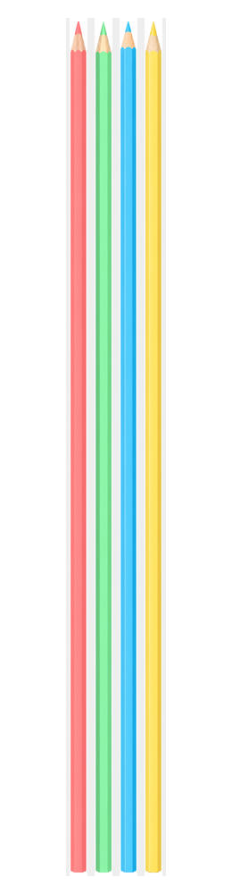
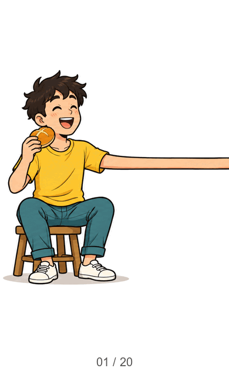

# sweety-x-image-play

把一个创意做成可以按顺序上传到 X 的独立图片：细长物件并排、完整画面连续切片、横滑揭晓，以及主体突破背景条框的出框效果。

这是给 AI 助手使用的 **Skill + 本地图片导出工具**。Skill 负责选择玩法、规划构图和调用图像生成；Python 脚本负责精确像素、切片顺序、打包与检查。你也可以直接用自己的图片运行脚本。


*上图是带间距的效果预览。上传文件是 20 张独立 PNG，不是这张拼图。*

## 能做什么

| 玩法 | 适合的内容 | 制作方式 |
|---|---|---|
| 独立窄条 `independent` | 充电线、铅笔、竹子、饼干棒 | 每个物件独立出图，保留端点比例，只延长明确指定的中段 |
| 连续切片 `panorama` | 列车、游龙、山水、横贯画面的互动 | 先完成一张母图，再按像素坐标连续裁切 |
| 横滑揭晓 `reveal` | 绳子通向哪里、手臂碰到了谁 | 首图建立动作，中段延伸，尾图揭晓；支持复用中段或指定逐张素材 |
| 主体出框 `breakout` | 递出的物件、宠物伸爪、产品或植物轮廓 | 明确主角与排除对象，背景统一分条；默认导出 20 张等宽透明 PNG |

导出工具支持 **2–20 张**，每张宽高由方案决定。`40×1920` 是细长物件的一种制作规格，**不是 X 官方要求，也不适合所有内容**。

## 原创示例

这些示例由 Codex 内置图像生成工具制作母图，再由脚本裁切；没有收录参考帖作者的图片或用户上传的人像。

| 示例 | 实际文件规格 | 成品 | 预览 |
|---|---|---|---|
| 独立窄条：四支彩铅 | 4 张，每张 40×1920 | [下载 ZIP](examples/pencils-independent/set/images.zip) · [逐张文件](examples/pencils-independent/set/images) | [并排预览](examples/pencils-independent/preview.png) |
| 横滑揭晓：伸长手臂摸猫头 | 20 张，每张 780×1200 | [下载 ZIP](examples/arm-reveal/set/images.zip) · [逐张文件](examples/arm-reveal/set/images) | [逐帧演示](examples/arm-reveal/sequence.gif) · [首中尾对照](examples/arm-reveal/preview.png) |
| 云海列车 | 20 张，每张 76×1024 | [下载 ZIP](examples/mountain-train/set/images.zip) · [逐张文件](examples/mountain-train/set/images) | [母图](examples/mountain-train/master.png) · [模拟拼图](examples/mountain-train/preview.png) |
| 机器人与猫咪 | 20 张，每张 76×1024 | [下载 ZIP](examples/robot-cat/set/images.zip) · [逐张文件](examples/robot-cat/set/images) | [母图](examples/robot-cat/master.png) · [模拟拼图](examples/robot-cat/preview.png) |
| 云中游龙 | 20 张，每张 76×1024 | [下载 ZIP](examples/cloud-dragon/set/images.zip) · [逐张文件](examples/cloud-dragon/set/images) | [母图](examples/cloud-dragon/master.png) · [模拟拼图](examples/cloud-dragon/preview.png) |

### 玩法看哪里

**独立窄条：每张是一件完整的物体。** 四支彩铅各占一张 40×1920 图片，并排时突出细长比例。



**连续切片：所有图片拼成一幅画。** 页首的列车是连续切片，轨道和桥梁从一张接到下一张。

**横滑揭晓：首图开始动作，末图才给答案。** 人物伸出手臂，中段持续延长，最后摸到猫咪头。以下是按成品顺序制作的本地逐帧演示，不是 X 实机录屏；上传的仍是 20 张独立 PNG。



[首图／中段／尾图静态对照](examples/arm-reveal/preview.png)。中段资产在实际成品中重复 18 次。配套 [plan.json](examples/arm-reveal/plan.json) 使用 `reveal` 的 `head`、`bridge`、`tail` 字段，可直接复现。人物与猫咪为新生成素材；玩法参考 [原帖](https://x.com/ripped1taliano/status/2121044139705778359)。

每套附有 `preview.html`：下载仓库后在本地浏览器打开，可调显示高度、图间距并滑到末尾。GitHub 文件页显示 HTML 源码，不会直接运行预览。此页面模拟横排关系，**不等于 X 客户端验收**。

**主体出框：背景被分条，前景保持连续。** 新增玩法参考 [这个 5 图帖子](https://x.com/xinzones/status/2121241605218947205)。一张宽主图内部的透明条缝，被前景物体局部盖住，产生纵深错觉；真实附件间距不能被覆盖。Skill 会依据用户原图选择语义主角，不把抓握、承托或遮挡它的其他物体自动并入。例如突出石头时只选石头，手仍参与背景分条。默认 20 张、每张 80 px 宽；先等比准备总宽 1600 px 的母图和蒙版，再合成导出。

图像语义由助手判断并制作准确蒙版；脚本负责等宽切分、检查准备后母图的目标像素是否保留，以及独立文件导出。等宽切片无法消除平台的真实附件间隙；历史宽主图 + 窄侧条仅作为显式可选方案。它**不是自动抠图模型**。详细选择依据和限制见 [主体出框说明](references/subject-breakout.md)，可直接复用 [通用提示词](references/breakout-prompts.md)。

三套连续切片的母图原尺寸为 1536×1024；为得到 20 张等宽切片，左右各裁 8 像素，得到 1520×1024。没有把整幅图挤窄或拉长。手臂揭晓使用三类 780×1200 素材：从 2172×724 母图取得三块 724×724 区域，分别等比缩放至 780×780，再上下补白；以首图 + 18 张中段 + 尾图组成序列。四支彩铅复用本项目早前完成的原创成品。五套合计 84 张独立 PNG。

## 安装到 Codex

需要 Git、Python 3.9+ 和 ImageMagick 7。图片生成使用助手自身的图像工具，导出脚本不需要 API Key，不发网络请求。

macOS 已安装 Homebrew 时，可用 `brew install imagemagick` 安装图片处理依赖。

将仓库克隆到 Codex 的技能目录；若目标已存在，请先检查已有版本，不要覆盖个人修改：

```bash
git clone https://github.com/threerocks/sweety-x-image-play.git \
  "${CODEX_HOME:-$HOME/.codex}/skills/sweety-x-image-play"
```

完整工作流还使用独立的 [sweety-image-privacy](https://github.com/threerocks/sweety-skills/tree/main/skills/sweety-image-privacy) 清理图片隐私信息。它不随本仓库捆绑。将该技能安装到同一技能目录后再做完整交付；缺少时助手应明确报告，不能把基础清理说成完整流程。该依赖的相机模拟字段会在本工具 `finalize` 步骤被删除，不把 AI 图片伪装成实拍。

打开新的 Codex 对话，输入：

> 使用 $sweety-x-image-play，做一组云海列车连续切片。20 张独立图片，每张 76×1024，按顺序编号。给我单图、ZIP 和模拟预览，检查拼回后与母图一致。

已有图片也可以：

> 使用 $sweety-x-image-play，把这张图连续竖切为 20 张。先计算原尺寸能否整除；尽量保留原图，不拉伸，明确告诉我每张实际尺寸。

独立窄条示例：

> 做四根不同颜色的充电线，每张严格 40×1920。保留接头比例，只延长线身。交付四张独立图片，不要用预览拼图代替。

主体出框示例：

> 用这张图做主体出框：根据画面判断突出哪个物件或动作，保持原图人物和物体不变。明确哪些邻近物体不参与出框。背景使用统一透明条缝，导出 20 张，每张 80 像素宽、同高；检查浅深底和实际附件间距。

## 不用 AI，也能运行切片工具

在仓库根目录运行：

```bash
python3 scripts/export_images.py build examples/mountain-train/plan.json \
  --out output/train-demo
python3 scripts/export_images.py audit output/train-demo
```

首次 `build` 已做基础元数据清理和文件检查，但 `privacy_skill` 仍是 `pending`。完整流程在使用隐私技能处理 `output/train-demo/images/`、取得 JSON 报告后执行：

```bash
python3 scripts/export_images.py finalize output/train-demo \
  --privacy-report /absolute/path/privacy-report.json
python3 scripts/export_images.py audit output/train-demo
```

如果该依赖确实不可用，可以明确使用 `finalize output/train-demo --privacy-unavailable`。文件仍会基础清理与打包，但报告保留 `privacy_workflow_complete: false`，不能称为完整隐私验收。

输出目录必须是新目录；再次制作请改名为 `output/train-demo-v2`。脚本不会覆盖旧作品。

### 连续切片方案

```json
{
  "mode": "panorama",
  "count": 20,
  "width": 76,
  "height": 1024,
  "source": "master.png",
  "fit": "exact"
}
```

`source` 相对于方案文件所在目录解析。此方案要求母图恰好是 `20×76=1520` 像素宽、1024 像素高。`exact` 遇到尺寸不符会停止；明确选择 `contain` 才等比留边，选择 `cover` 才等比裁边。更多方案见 [导出参数](references/export-plans.md)。

### 输出内容

```text
final-set/
├── images/01.png … 20.png   按序上传的独立图片
├── images.zip               只含独立图片
├── preview.html             可调间距的本地预览
└── manifest.json            数量、宽高、摘要与验收状态
```

## 检查了什么

- 每张真实宽高、文件数量与顺序、PNG 解码、图片像素摘要。
- 连续切片拼回后与准备后的母图逐像素一致。
- 主体出框检查原图与蒙版同尺寸、默认 20×80 等宽规格、白色蒙版区域像素不变、真实切口位置记录、透明条缝及切片重组。
- ZIP 条目顺序、完整性以及每张文件与成品字节一致。
- 内嵌 EXIF、GPS、文本来源元数据；macOS 部分系统管理属性可能残留，报告会保留。
- 自动测试覆盖尺寸错误、越界、覆盖保护、篡改、ZIP 不一致、连续重组、端点保留，以及左/右/宽主体的动态布局和透明度保留。

运行测试：

```bash
python3 scripts/test_export_images.py
```

文件检查不能证明构图好看，也不能证明目标账号可以上传 20 张。图片里的水印和可见文字属于画面，不会被元数据清理删除。

## X 平台边界

2026-11-13 已观察到两条含 20 张附件的原帖；同时 X 的部分官方帮助页及创建帖子 API 文档仍写最多 4 张图片。原生客户端、账号开放情况和第三方 API 不能互相替代证明。参考链接与核实范围见 [来源记录](docs/research.md)。

这个项目**制作图片，不登录 X、不自动发布，也不解锁附件上限**。发布前按序号选择图片，检查目标客户端的裁切与排列。建议为切片添加简短 ALT 描述，说明它属于连续画面的第几张。

## 创作建议

先确定读者为什么要滑，再决定数量。长桥、绳子、龙身可以自然连接相邻图片；普通头像被切成二十份，五官可能正好落在界面缝隙里。遇到这种情况，减少切片数或换成更适合横向展开的构图。

对外介绍：[最初三种玩法的发布文章](docs/launch-article.zh-CN.md)。新增主体出框玩法以本页及专项说明为准。

详细说明：[创意模板](references/creative-recipes.md) · [Skill 入口](SKILL.md) · [实测参考帖](references/observed-examples.md)。

## 使用与贡献

欢迎提交包含输入尺寸、方案 JSON、实际结果和预期结果的 Issue。请不要附带账号凭据、私人图片或未经允许传播的素材。

代码和文档采用 MIT 许可，见 [LICENSE](LICENSE)。仓库原创 AI 示例按同一许可提供；这不代表任何国家均承认 AI 输出版权，也不构成对第三方权利的保证。外部链接指向的作品不在本仓库许可范围内。
